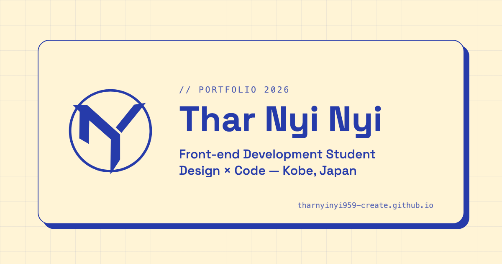

# Thar Nyi Nyi — Portfolio

**🔗 Live site: [tharnyinyi959-create.github.io](https://tharnyinyi959-create.github.io/)**



Portfolio of **Thar Nyi Nyi**, a front-end development student in Kobe, Japan (Graphic Design Department, Kobe Denshi College).
It presents 21 school projects — web design, graphic design, character design and video — each with its own case-study page.

> 神戸で学ぶフロントエンド開発学生のポートフォリオサイトです。Web・グラフィック・キャラクターデザイン・動画など21作品を、作品ごとの詳細ページで紹介しています。日本語 / English 切り替え対応。

---

## Highlights

- **No frameworks, no libraries** — plain HTML, CSS and JavaScript.
- **Two languages (JP / EN)** — a switch in the header; the choice is remembered across pages. All English text lives in one file, [`js/i18n.js`](js/i18n.js).
- **Opening animation** — the logo is built from three bars, a ring turns, and the logo breaks into shards as the page opens. It plays once, when a visitor enters the site; moving between pages shows no loading screen. It plays on by itself, can be scrolled, and can be skipped (button or `Esc`).
- **Interactive ID card** — the student-ID card on the home page hangs from a lanyard and can be dragged (mouse, touch or arrow keys); it swings back with simple spring physics.
- **Scroll-driven sections** — on desktop, each section stays in place while the next one slides over it; the project deck on the home page flips through cards as you scroll.
- **Accessibility** — keyboard support, visible focus, `prefers-reduced-motion` respected (animations are skipped), alt text on every image.
- **Performance** — images served as WebP (14.5 MB → 5.1 MB), images below the fold load lazily.
- **Lighthouse** — Accessibility **100** · Best Practices **100** · SEO **100** · Performance 98 (desktop)
- **Responsive** — tested at phone, tablet and desktop widths.

## Built with

| | |
|---|---|
| Languages | HTML5, CSS3 (custom properties, grid, `position: sticky`), JavaScript (ES2015+) |
| Design | Figma, Illustrator, Photoshop |
| Hosting | GitHub Pages |

Colours: Nordic Indigo `#263BAA` × Vanilla Mist `#FFF4D6` (design tokens at the top of `css/style.css`).

## Pages

| Page | |
|---|---|
| `index.html` | Home — hero, about (ID card), tools, project deck, contact |
| `profile.html` | Background and journey (Myanmar → Japan) |
| `works.html` | All 21 projects, filterable (Web / Graphic / Video) |
| `work-*.html` | One case study per project |
| `contact.html` | Contact form (sent through Formspree) |

## Project structure

```
index.html, profile.html, works.html, contact.html, work-*.html
css/       style.css (layout, components) · motion.css (reveals, deck, ID card) · v2-motion.css (scroll layers)
js/        i18n.js (EN/JP) · main.js (menu, contact form, works list) · motion.js · v2-motion.js
hero/      the code-window hero on the home page
loading/   loading.js/.css (opening animation) · page-loader.js/.css (quick loader when a visitor enters on another page)
assets/    images (WebP), icons, link-preview image
```

## Run locally

No build step. Open `index.html` in a browser, or serve the folder (needed for the contact form):

```bash
python3 -m http.server 8000
# then open http://localhost:8000
```

## Contact

- Email: [tharnyinyi959@gmail.com](mailto:tharnyinyi959@gmail.com)
- GitHub: [@tharnyinyi959-create](https://github.com/tharnyinyi959-create)

---

<details>
<summary>Developer notes (URL flags)</summary>

- `?intro=poster` — always play the opening · `?intro=off` — skip it · `?introSpeed=0.3` — slow motion
- `?hero=classic` — the plain hero instead of the code window
- Opening tuning: `window.LOGO_LOADING_INDIGO_CONFIG = { speed: 1.2, scrollDistance: 650, autoPlay: 2600 }`
- The home page's first section is built by `hero/coding-hero.js` in front of the empty `<section class="hero">` anchor — keep that anchor.

</details>
